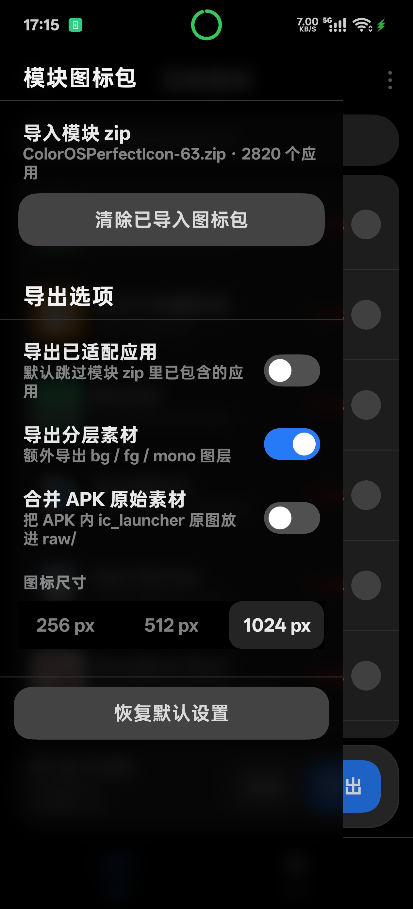
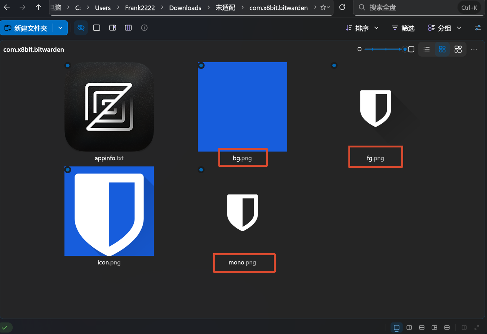

# 利用配套软件快速适配

配套软件（`ColorOS17PerfectIcon.apk`）会列出手机上所有「未适配」的应用，并支持把原始素材直接导出。
把导出的素材交给 AI，就能按下面的流程快速补齐图标。

## 操作步骤

1. 在配套软件中导入最新的模块 zip（可在 [Releases](../../releases) 下载）。

   

2. 筛选「未适配」，选中目标应用后点击导出。部分应用已经做好分层，导出目录中通常包含：

   | 文件 | 用途 |
   | --- | --- |
   | `bg.png` | 亮色模式底板 |
   | `fg.png` / `mono.png` | 前景图（有些是镂空的） |

3. 把导出目录发给 AI，并附上下面这段说明：

   ```text
   bg 是亮色模式背景，fg / mono 是前景图
   这两张图足够做出亮色、暗色两个图标
   请先阅读根目录 README 和 doc/ 下的适配文档
   完成这个软件的适配
   ```

   

4. 适配结果按 [新增适配软件](新增适配软件.md) 的要求登记 XML，并用检查脚本验证。
